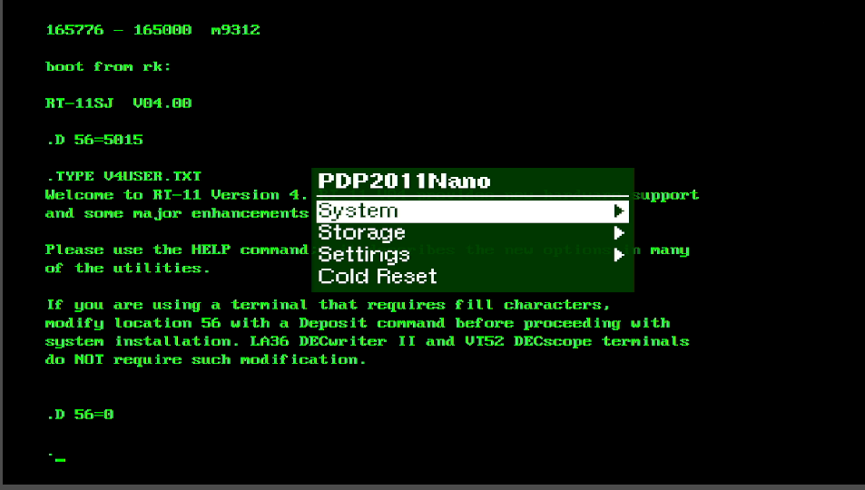

## License:

The original pdp2011 VHDL code is copyright © 2008–2024 [Sytse van Slooten](https://pdp2011.sytse.net). See [LICENSE](LICENSE) for the terms that apply to this project.

# PDP2011Nano

PDP2011Nano is a PDP-11 FPGA core for Tang and MiSTle boards, derived from the [pdp2011](https://pdp2011.sytse.net) core and modified to add features such as 32bit DRAM support, a pipelined MMU to save resources and an alternative VT52 terminal console.

| Board      | FPGA       | support |Note|
| ---        |        -   | -     |-|
| [Tang Console 60K NEO](https://wiki.sipeed.com/hardware/en/tang/tang-console/mega-console.html)|[GW5AT-60](https://www.gowinsemi.com/en/product/detail/60/) | HDMI||
| [Tang Nano 20k](https://wiki.sipeed.com/nano20k)     | [GW2AR](https://www.gowinsemi.com/en/product/detail/38/)  | HDMI ||
| [Tang Primer 25K](https://wiki.sipeed.com/hardware/en/tang/tang-primer-25k/primer-25k.html) | [GW5A-25](https://www.gowinsemi.com/en/product/detail/60/) | HDMI | |
| [MiSTle-25k](https://github.com/MiSTle-Dev/Boards/tree/main/mistle_gw3a_20) |[GW5A-25](https://www.gowinsemi.com/en/product/detail/60/)|HDMI ||

This project relies on a MPU being connected to the FPGA (onboard BL616 or external one). --> [MiSTle-Dev wiki](https://github.com/MiSTle-Dev/.github/wiki) <--  

  

## Features

tbd

Note:  
Due to FPGA resource limitations TN20k allows presently only a single disk type (RK) using the default VT100. If a VT52 build is used then two disks are possible. GW5A boards allow three types (RK, RL, RH). Support of tape (TC) and paper tape is a future feature candidate.